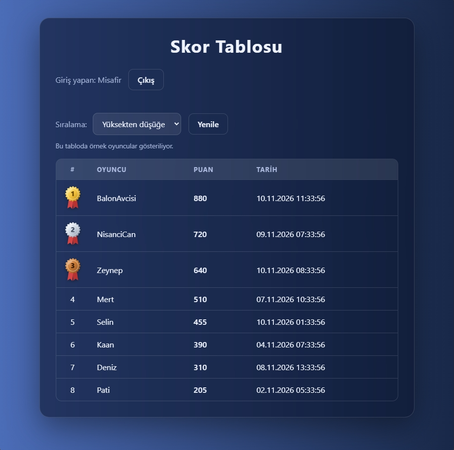

# Skor Tablosu

ASP.NET Core ile yazılmış, oyuncuların kayıt olup giriş yaptığı ve skorlarının bir tabloda sıralandığı bir web uygulaması.



## Özellikler

- Kayıt ve giriş (JWT ile), şifreler hash'lenerek saklanır
- Skor tablosu giriş yaptıktan sonra görünür
- Sıralama seçenekleri: en yeni, yüksekten düşüğe, düşükten yükseğe
- İlk üç sıraya kodla çizilmiş altın, gümüş ve bronz madalya (SVG)
- Her oyuncunun tabloda tek satırı vardır ve en iyi skorunu saklar
- Giriş yapan oyuncunun satırı vurgulanır
- Tablo satırları sırayla beliren hafif bir animasyonla gelir
- İlk çalıştırmada veritabanı boşsa örnek oyuncularla dolar
- Kullanıcı verisi HTML olarak yorumlanmaz (XSS'e karşı güvenli listeleme)

## Kurallar

- Kullanıcı adı boş olamaz, en fazla 30 karakter olabilir ve benzersiz olmalı
- Şifre en az 6 karakter olmalı
- Puan negatif olamaz

Kurallara uymayan istekler `400 Bad Request`, var olan kullanıcı adıyla kayıt `409 Conflict`, olmayan oyuncu `404 Not Found`, yanlış şifre `401 Unauthorized` ile reddedilir.

## Neler öğrendim

- ASP.NET Core Minimal API ile endpoint yazmak (GET, POST, route parametreleri, durum kodları)
- Entity Framework Core ve SQLite ile veriyi kalıcı saklamak
- Şifre hash'leme ve JWT ile kimlik doğrulama
- Sunucu tarafında doğrulama (validation) ve XSS'e karşı korunma
- Gizli anahtarları depoya koymamak (User Secrets)
- Git ve GitHub ile sürüm takibi
- Saf CSS ile tema (CSS değişkenleri, gradient, animasyon) ve SVG çizimi

## Kullanılan teknolojiler

- C# / ASP.NET Core (Minimal API)
- Entity Framework Core
- SQLite
- JWT (JSON Web Token)
- HTML, CSS, JavaScript

## Nasıl çalıştırılır?

1. Projeyi indir: `git clone https://github.com/ereningoai-cloud/skor-tablosu-api.git`
2. Visual Studio ile `IlkApi.slnx` dosyasını aç
3. Gizli anahtarı ayarla (token imzası için, depoda yok): proje adına sağ tıkla → **Manage User Secrets** ve şunu yaz (uzun, rastgele bir yazı kullan):
   `{ "Jwt:Key": "en-az-32-karakterlik-rastgele-bir-yazi" }`
4. F5 ile çalıştır
5. Açılan sayfada kayıt ol, giriş yap, tabloya bak

Veritabanı dosyası (`skorlar.db`) ilk çalıştırmada otomatik oluşur ve depoya dahil değildir. Boşsa içine örnek oyuncular eklenir. Bu oyuncuların şifresi rastgele üretilir ve kimse bilmez, onlarla giriş yapılamaz, sadece tabloda görünürler.

### Kendi skorunu eklemek

Web arayüzünde skor ekleme formu yok. Skorlar `POST /skorlar/gonder` ile, giriş yapmış oyuncudan gelir. Denemek için giriş yaptıktan sonra sayfada tarayıcı konsoluna (F12) şunu yapıştırıp **Yenile**'ye basabilirsin:

```javascript
fetch("/skorlar/gonder", {
  method: "POST",
  headers: { "Content-Type": "application/json", Authorization: "Bearer " + sessionStorage.getItem("token") },
  body: JSON.stringify({ puan: 500 })
})
```

Sunucu yalnızca oyuncunun önceki en iyi skorunu geçen puanları kaydeder.

## Endpoint'ler

| Yöntem | Adres | Açıklama |
|---|---|---|
| GET | / | API'nin çalıştığını gösterir |
| GET | /skorlar | Tüm skorları getirir |
| GET | /skorlar/{id} | Id'si verilen skoru getirir |
| GET | /skorlar/en-yuksek | En yüksek puanlı skoru getirir |
| POST | /skorlar/gonder | Giriş yapan oyuncunun puanını gönderir, rekor kırılırsa kaydeder (giriş gerekir) |
| POST | /kayit | Yeni kullanıcı kaydı |
| POST | /giris | Giriş yapar, token döner |
| GET | /ben | Giriş yapan kullanıcıyı gösterir (giriş gerekir) |